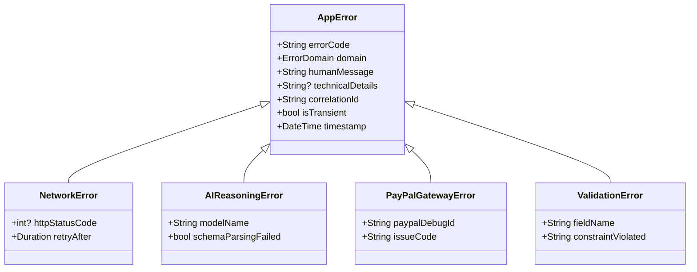
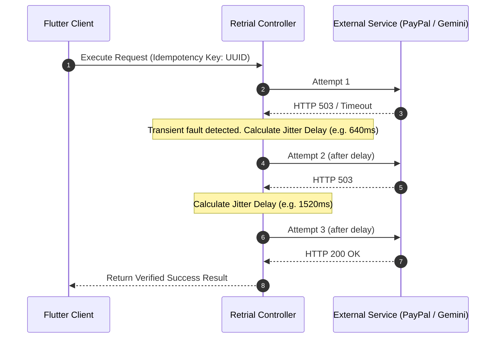

# Error Handling and Retrial Specification

**Document Version:** 1.0.0  
**Subsystem:** Core Resilience & Fault Management  
**Mandate:** Zero Silent Fallbacks. Transparent Error Reporting. Structured Automated & Manual Retrials.

---

## 1. The Zero-Silent-Fallback Doctrine

In consumer applications, silent fallbacks (e.g., silently switching to cached stale data or suppressing failed analytics) are often tolerated. In cross-border financial transactions and scam protection, however, silent fallbacks are dangerous:
* Falling back to a "safe" default risk score when a security analysis fails could lull a user into trusting a malicious scammer.
* Silently falling back to an approximate or hardcoded exchange rate during payment processing creates financial loss, discrepancy disputes, and regulatory breaches.
* Hiding an API timeout behind a generic, ambiguous message leaves the user uncertain whether funds were deducted.

**Core Rules:**
1. **Never Fall Back to Guesswork:** If an exchange rate API, AI inference engine, or PayPal endpoint is unresponsive, the system must never generate estimated synthetic numbers or assumed safe defaults.
2. **Transparent Error Attribution:** Every error must clearly report its origin domain (Client, Network, Supabase Backend, Gemini AI, or PayPal Sandbox).
3. **Preserve User Inputs on Failure:** Form fields, pasted messages, uploaded evidence, and payment configurations must never be cleared when an operation fails.
4. **Structured Retrial:** Transient errors must execute deterministic retrials with backoff, while persistent failures must present unambiguous manual retrial controls.

---

## 2. Error Taxonomy & Classification

Every error in Veltro is modeled as an immutable `AppError` object:



### Classification Domains

| Domain Code | Description | Typical Cause | Transient / Retriable? |
| :--- | :--- | :--- | :--- |
| `ERR_DOMAIN_NETWORK` | Socket timeouts, DNS resolution failures, offline client. | Weak cellular signal, packet drops. | Yes (Automated retrial with backoff). |
| `ERR_DOMAIN_AI` | Gemini rate limits (429), unparseable JSON response, context limit. | High traffic, unexpected token output. | Yes (Up to 3 retrials, then manual prompt). |
| `ERR_DOMAIN_PAYPAL` | Invalid credentials, order decline, sandbox API downtime, 422 errors. | Issuer decline, restricted country corridor. | Conditional (Transient 5xx/429 retriable; 422 requires user edit). |
| `ERR_DOMAIN_AUTH` | Expired JWT token, unauthorized resource access. | Stale session, revoked credentials. | Token refresh retriable; manual login if expired. |
| `ERR_DOMAIN_VALIDATION`| Invalid IBAN/email, unsupported currency, unreadable image. | Malformed user input, corrupted upload. | No (Requires explicit input adjustment). |

---

## 3. Retrial Policies & Algorithms

### 3.1 Transient Fault Automated Retrial (Full Jitter Backoff)
For transient failures (`ERR_DOMAIN_NETWORK`, HTTP 429, HTTP 502/503), the client or edge function executes a bounded retrial sequence.

The delay for attempt $k \in \{1, 2, 3\}$ is computed as:
$$t_k = \text{random}(0, \min(T_{\text{max}}, T_{\text{base}} \cdot 2^{k-1}))$$
where:
* $T_{\text{base}} = 800\text{ ms}$
* $T_{\text{max}} = 5000\text{ ms}$
* Full randomization prevents synchronization stampedes on backend services.



If attempt 3 fails, the automated loop terminates, and the UI immediately renders the **Explicit Failure Presentation**.

### 3.2 Idempotency Invariance
To ensure safe retrials on payment mutations:
* Every order creation generates a persistent `PayPal-Request-Id` prior to attempt 1.
* The identical request ID is transmitted during attempts 2 and 3. PayPal Sandbox recognizes the header and returns the existing resource rather than creating duplicate orders.

---

## 4. User Interface Error Presentation Guidelines

### 4.1 Visual & Structural Guidelines
* **Standard Icons Only:** Represent error states using Google Material standard icons:
  * Network Error: `Icons.wifi_off_outlined`
  * Gateway / Payment Error: `Icons.payment_outlined` or `Icons.error_outline`
  * Security Alert: `Icons.gpp_bad_outlined`
  * Security Warning: `Icons.shield_outlined`
  * Retrial Action: `Icons.refresh_outlined`
* **Zero Emojis:** Prohibit emojis across all error messages, snackbars, and alert banners.
* **Component Architecture:**
  1. **Primary Title:** Concise identification of what failed.
  2. **Plain-Language Explanation:** Clear description of why it failed without obfuscation.
  3. **Technical Diagnostics Container:** Collapsible section displaying HTTP status, internal error code, and correlation ID for debugging.
  4. **Action Area:**
     * Primary CTA: **Retry Now** (re-executes the exact operation with current inputs).
     * Secondary CTA: **Review Input** or **Cancel**.

### 4.2 Example Error UI Layout (Flutter Implementation Pattern)

```dart
// Conceptual UI Representation for Failed Security Scan or Payment
Widget buildErrorStateCard({
  required BuildContext context,
  required AppError error,
  required VoidCallback onRetry,
  required VoidCallback onCancel,
}) {
  return Container(
    margin: const EdgeInsets.all(16.0),
    padding: const EdgeInsets.all(20.0),
    decoration: BoxDecoration(
      color: Theme.of(context).colorScheme.errorContainer.withOpacity(0.15),
      borderRadius: BorderRadius.circular(12.0),
      border: Border.all(
        color: Theme.of(context).colorScheme.error,
        width: 1.5,
      ),
    ),
    child: Column(
      mainAxisSize: MainAxisSize.min,
      crossAxisAlignment: CrossAxisAlignment.start,
      children: [
        Row(
          children: [
            Icon(
              Icons.error_outline,
              color: Theme.of(context).colorScheme.error,
              size: 28.0,
            ),
            const SizedBox(width: 12.0),
            Expanded(
              child: Text(
                error.humanMessage,
                style: Theme.of(context).textTheme.titleMedium?.copyWith(
                  fontWeight: FontWeight.bold,
                  color: Theme.of(context).colorScheme.onErrorContainer,
                ),
              ),
            ),
          ],
        ),
        const SizedBox(height: 12.0),
        Text(
          "We could not complete this operation. No funds were moved and no unverified data was assumed.",
          style: Theme.of(context).textTheme.bodyMedium,
        ),
        const SizedBox(height: 12.0),
        Container(
          padding: const EdgeInsets.all(10.0),
          decoration: BoxDecoration(
            color: Colors.black.withOpacity(0.04),
            borderRadius: BorderRadius.circular(6.0),
          ),
          child: SelectableText(
            "Code: ${error.errorCode} | Ref: ${error.correlationId}",
            style: const TextStyle(
              fontFamily: 'monospace',
              fontSize: 12.0,
            ),
          ),
        ),
        const SizedBox(height: 16.0),
        Row(
          mainAxisAlignment: MainAxisAlignment.end,
          children: [
            OutlinedButton(
              onPressed: onCancel,
              child: const Text("Dismiss"),
            ),
            const SizedBox(width: 12.0),
            FilledButton.icon(
              icon: const Icon(Icons.refresh_outlined, size: 18.0),
              label: const Text("Retry Operation"),
              onPressed: onRetry,
            ),
          ],
        ),
      ],
    ),
  );
}
```

---

## 5. Dart / Flutter Retry Helper Implementation Contract

```dart
/// Typed result encapsulation avoiding silent nulls or ambiguous exceptions
sealed class Result<T> {
  const Result();
}

class Success<T> extends Result<T> {
  final T data;
  const Success(this.data);
}

class Failure<T> extends Result<T> {
  final AppError error;
  const Failure(this.error);
}

/// Generic Retrial Executor utility
class RetryExecutor {
  static Future<Result<T>> executeWithRetries<T>({
    required Future<T> Function() operation,
    required String actionName,
    int maxAttempts = 3,
    Duration baseDelay = const Duration(milliseconds: 800),
  }) async {
    int attempt = 0;
    while (attempt < maxAttempts) {
      attempt++;
      try {
        final result = await operation();
        return Success(result);
      } catch (exception) {
        final isLastAttempt = attempt >= maxAttempts;
        if (isLastAttempt || !_isTransientException(exception)) {
          return Failure(
            AppError.fromException(
              exception: exception,
              actionName: actionName,
            ),
          );
        }
        // Jittered backoff delay
        final backoffMs = baseDelay.inMilliseconds * (1 << (attempt - 1));
        await Future.delayed(Duration(milliseconds: backoffMs));
      }
    }
    return Failure(
      AppError(
        errorCode: "ERR_RETRIES_EXHAUSTED",
        domain: ErrorDomain.network,
        humanMessage: "Operation failed after multiple attempts.",
        correlationId: DateTime.now().millisecondsSinceEpoch.toString(),
        isTransient: false,
      ),
    );
  }

  static bool _isTransientException(dynamic exception) {
    // Check for network timeouts, HTTP 429, HTTP 503
    return true; 
  }
}
```
