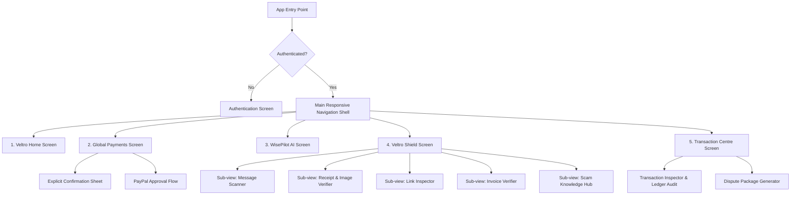

# Flutter Development AI Agent Implementation Specification

**Platform:** Veltro — Intelligent Global Payments & Anti-Scam Platform  
**Target:** Implementation Guide for Autonomous Flutter Development AI Agent  
**Framework:** Flutter 3.x (Web, Mobile, Desktop)  
**State Architecture:** Clean Architecture with Riverpod / StateNotifier  
**Design Standard:** Material Design 3 (Strict standard icons only. Zero emojis. Zero low-quality SVG assets.)  
**Resilience Standard:** Zero Silent Fallbacks. Explicit Error Surfacing. Structured Retrial Mechanisms.

---

## 1. Design System & Iconography Guidelines

### 1.1 Color Tokens & Theming
```dart
abstract class VeltroTheme {
  // Brand Primary & Accents
  static const Color primaryNavy = Color(0xFF0A192F);
  static const Color accentCyan = Color(0xFF00D2FF);
  static const Color surfaceDark = Color(0xFF0F172A);
  static const Color cardDark = Color(0xFF1E293B);
  
  // Status & Risk Tiers
  static const Color riskLow = Color(0xFF10B981);       // Verified / Safe
  static const Color riskMedium = Color(0xFFF59E0B);    // Advisory / Caution
  static const Color riskHigh = Color(0xFFF97316);      // Elevated Threat
  static const Color riskCritical = Color(0xFFEF4444);  // Imminent Fraud
  
  // Neutral Greys
  static const Color textPrimary = Color(0xFFF8FAFC);
  static const Color textSecondary = Color(0xFF94A3B8);
  static const Color textMuted = Color(0xFF64748B);
  static const Color borderDefault = Color(0xFF334155);
}
```

### 1.2 Icon Mapping Standards (Strictly Standard Icons, Zero Emojis)
All icons must be resolved through Google Material Icons (`Icons.*`) or Material Symbols (`Symbols.*`):

| Conceptual Action / State | Standard Icon Reference | Prohibited Patterns |
| :--- | :--- | :--- |
| **Veltro Shield / Safe** | `Icons.shield_outlined` / `Icons.verified_user_outlined` | Emojis (e.g., shield, lock) |
| **Critical Scam Warning** | `Icons.gpp_bad_outlined` / `Icons.report_problem_outlined` | Emojis (e.g., warning triangle) |
| **WisePilot AI** | `Icons.psychology_outlined` / `Icons.auto_awesome_outlined`| Emojis (e.g., robot, sparkles) |
| **Payment / Transfer** | `Icons.send_outlined` / `Icons.swap_horiz_outlined` | Emojis (e.g., money bag, flying cash) |
| **PayPal Verified Status** | `Icons.check_circle_outline` | Emojis (e.g., green check) |
| **Receipt / Invoice** | `Icons.receipt_long_outlined` / `Icons.description_outlined`| Emojis (e.g., document, invoice) |
| **Error / Retrial** | `Icons.error_outline` / `Icons.refresh_outlined` | Emojis (e.g., cross mark, alert) |

---

## 2. Screen Specifications & UI Hierarchy



---

### 2.1 Screen 1: Veltro Home (`/home`)
* **Purpose:** High-level dashboard delivering financial awareness, market rates, and proactive threat summaries.
* **Layout Structure:**
  1. **Top Bar:** User profile avatar, current active wallet balance, notifications trigger (`Icons.notifications_outlined`), and threat status badge.
  2. **Security Readiness Banner:** Shows status of Veltro Shield: active protection, count of scans conducted, and unresolved risk alerts.
  3. **Live Exchange Rate Matrix:** Real-time mid-market rates for corridors (USD/EUR, USD/KES, USD/NGN, USD/INR, USD/PHP) with transparent spread indicators.
  4. **Quick Action Grid:**
     * "Send via PayPal" (`Icons.send_outlined`)
     * "Scan Message / Receipt" (`Icons.shield_outlined`)
     * "Consult WisePilot" (`Icons.auto_awesome_outlined`)
     * "Track Payment" (`Icons.receipt_long_outlined`)
  5. **Recent Verified Activity:** Stream of recently cleared or audited transactions.

---

### 2.2 Screen 2: Global Payments & Route Comparison (`/payments`)
* **Purpose:** Compare international corridors, calculate net payouts and processing fees, and execute payments through the PayPal Developer Sandbox.
* **Key Components:**
  1. **Corridor Configurator:**
     * Source currency dropdown and amount input field.
     * Target currency dropdown and computed net recipient amount.
     * Guaranteed rate lock countdown timer (e.g., 15 minutes).
  2. **Fee & Spread Breakdown Panel:**
     * Mid-market exchange rate.
     * Variable conversion spread.
     * Fixed PayPal processing fee.
     * Estimated time of settlement.
  3. **Route Comparison Cards:** Side-by-side comparison between PayPal Account Balance, PayPal Linked Debit/Credit Card, and alternative standard wire rails.
  4. **Explicit Authorization Sheet (Mandatory Guardrail):**
     * Modal dialog requiring biometric or password confirmation.
     * Clearly states: "You are authorizing an irreversible cross-border payment of X USD yielding Y target currency."
     * Unskippable checkbox: "I have confirmed the recipient details and understand payment is final."
  5. **PayPal Checkout Capture:** Initiates PayPal Sandbox Order creation, loads approval session, and verifies capture upon return.

---

### 2.3 Screen 3: WisePilot AI Assistant (`/wisepilot`)
* **Purpose:** Multi-turn conversational interface providing context-aware guidance on fees, compliance, and scam risks.
* **Key Components:**
  1. **Conversation Stream:** Clean message list with distinct visual distinction between User and WisePilot.
  2. **Tool Execution Cards:** When WisePilot executes a tool (e.g., calculating fees or checking transaction status), an interactive card renders inline showing input parameters, live status, and computed outputs.
  3. **Actionable Transfer Intent Card:** If the user agrees to a proposed transfer, WisePilot generates an embedded card with a "Review & Pay with PayPal" button that transitions directly to the Payments sheet.
  4. **Strict Error Surfacing:** If the AI gateway experiences rate limiting or an unparseable response, an explicit error card appears inline with a "Retry Question" button.

---

### 2.4 Screen 4: Veltro Shield Anti-Scam Suite (`/shield`)
* **Purpose:** Proactive security scanner for messages, screenshots, links, and invoices.
* **Sub-Navigation Tabs:**
  * **Tab A: Message & Email Scanner:** Text area supporting pasting of transaction emails, WhatsApp chats, or marketplace DMs. Triggers NLP threat analysis.
  * **Tab B: Receipt & Confirmation Verifier:** Drag-and-drop file upload for PNG, JPG, and PDF receipts. Performs OCR inspection and direct PayPal API verification.
  * **Tab C: Link & Phishing Inspector:** Input bar for checking suspected payment URLs against typosquatting, spoofing, and malicious redirection.
  * **Tab D: Invoice & Payee Verifier:** Parses supplier invoices to highlight bank routing drift and altered settlement details.
  * **Tab E: Scam Knowledge Hub:** Searchable directory detailing common scams (Overpayment schemes, Fake courier fees, Advance fee fraud, Phishing dispute notices).
* **Scan Result Presentation:**
  * Distinct risk header: `LOW` (Green), `MEDIUM` (Amber), `HIGH` (Orange), or `CRITICAL` (Red).
  * Confidence score percentage.
  * List of identified threat indicators with severity markers.
  * Actionable guidance bullet points.
  * Direct action button: "Archive in Incident Reports" or "Start Dispute File".

---

### 2.5 Screen 5: Transaction Centre & Audit (`/transactions`)
* **Purpose:** Provable transaction ledger with real-time status and dispute documentation tools.
* **Key Components:**
  1. **Ledger Table:** Searchable by Transaction ID, Recipient, Date, and Status.
  2. **Verified Status Badges:**
     * `CREATED` (Blue)
     * `APPROVED` (Purple)
     * `COMPLETED` (Green)
     * `DENIED` (Red)
  3. **Transaction Details Inspector:** Displays PayPal Order ID, Capture ID, applied FX rate, timestamps, and cryptographic webhook verification status.
  4. **Dispute Preparation Assistant:** One-click generation of a consolidated PDF/JSON audit dossier containing verified timestamps, chat transcripts, and API logs.

---

## 3. End-to-End User Journeys

### Journey 1: Cross-Border Quote to PayPal Sandbox Payment
1. User opens **Global Payments** and enters `150.00 USD` targeting `KES` (Kenyan Shillings).
2. The UI computes the exchange rate (`1 USD = 129.50 KES`), calculates the transparent fee (`3.50 USD`), and displays recipient amount (`18,971.75 KES`).
3. User selects "Pay with PayPal".
4. The system opens the **Explicit Authorization Sheet**. The user confirms recipient email and amounts.
5. Client invokes backend Edge Function `POST /paypal/create-order`.
6. PayPal returns `order_id` and approval URL.
7. User approves via sandbox flow. The client captures the order via `POST /paypal/capture-order`.
8. Order status updates to `COMPLETED` and appears immediately in the Transaction Centre.

---

### Journey 2: Inspecting a Fake Payment Screenshot
1. A freelance client sends an image claiming: *"I have sent $500 via PayPal. Here is the receipt. Please release the code repository."*
2. Freelancer navigates to **Veltro Shield > Receipt Verifier** and uploads the screenshot.
3. Multi-modal OCR analyzes image geometry, typeface alignment, and extracts claimed Transaction ID: `5O190127TN364715T`.
4. Veltro Shield queries PayPal API: `GET /v2/checkout/orders/5O190127TN364715T`.
5. Result: PayPal returns HTTP 404 (Resource Not Found).
6. Shield displays a **CRITICAL Risk Alert**:
   * Indicator: *"Fabricated Transaction Reference: Transaction ID does not exist in PayPal records."*
   * Indicator: *"Visual Discrepancy: Typeface kerning does not match standard PayPal receipt layout."*
   * Warning: *"Do not release deliverables. A screenshot is never proof of funds arrival."*
7. Freelancer clicks "Save to Incident Reports".

---

### Journey 3: Consulting WisePilot with Guardrails
1. User asks WisePilot: *"Someone told me they will wire me $1,000 if I first pay an $80 clearance fee via crypto. Is this normal?"*
2. WisePilot parses message intent and recognizes classic Advance Fee Fraud.
3. WisePilot invokes `scan_security_threat("MESSAGE", prompt)`.
4. WisePilot returns a structured warning card:
   * Classification: **CRITICAL Risk (Advance Fee Fraud)**.
   * Explanation: *"Legitimate international transfers through PayPal or banking networks do not require upfront third-party deposits or cryptocurrency fees."*
   * Recommendation: *"Immediately cease communication. Do not send any funds."*

---

## 4. Edge Functions & AI Tool Specifications

### 4.1 Edge Function: `create-paypal-order`
* **Route:** `POST /functions/v1/create-paypal-order`
* **Headers:** `Authorization: Bearer <SUPABASE_JWT>`
* **Payload:**
```json
{
  "source_currency": "USD",
  "target_currency": "KES",
  "send_amount": 150.00,
  "recipient_identifier": "recipient@example.com",
  "idempotency_key": "c7a8b190-3f41-4712-92a8-8b9821a71920"
}
```
* **Success Output:**
```json
{
  "order_id": "8920192837",
  "status": "CREATED",
  "approval_url": "https://www.sandbox.paypal.com/checkoutnow?token=8920192837"
}
```

---

### 4.2 Edge Function: `shield-inspect`
* **Route:** `POST /functions/v1/shield-inspect`
* **Headers:** `Authorization: Bearer <SUPABASE_JWT>`
* **Payload:**
```json
{
  "scan_type": "MESSAGE",
  "input_text": "Kindly send back the $200 extra I sent to your account before it clears."
}
```
* **AI Evaluation Pipeline:**
  1. Sanitizes PII (strips credit card numbers, passwords).
  2. Formulates prompt with strict JSON Schema output.
  3. Evaluates with Gemini 1.5.
  4. Returns validated risk object.

---

## 5. Strict Error Handling & Retrial Flow for Flutter Agent

Every repository call and HTTP operation must implement the `Result<T>` pattern. Silent fallbacks are strictly prohibited.

```dart
// Error Reporting and Retrial Contract in Flutter
Future<void> executeWithRetrial({
  required BuildContext context,
  required Future<void> Function() task,
  required String operationDescription,
}) async {
  bool inProgress = true;
  int attempt = 0;
  const int maxAttempts = 3;

  while (inProgress && attempt < maxAttempts) {
    attempt++;
    try {
      await task();
      inProgress = false;
    } catch (error) {
      if (attempt >= maxAttempts) {
        inProgress = false;
        // Surface explicit error banner with manual retry trigger
        showErrorDialog(
          context: context,
          title: "Operation Failed",
          message: "Failed to $operationDescription after $maxAttempts attempts.",
          technicalDetails: error.toString(),
          onRetry: () => executeWithRetrial(
            context: context,
            task: task,
            operationDescription: operationDescription,
          ),
        );
      } else {
        // Exponential backoff delay
        await Future.delayed(Duration(milliseconds: 500 * (1 << attempt)));
      }
    }
  }
}
```
