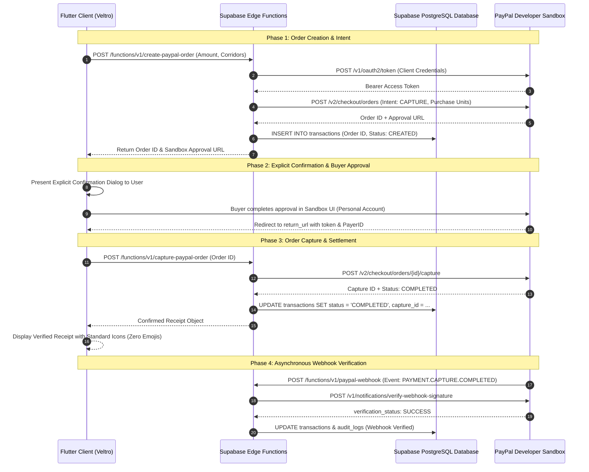

# PayPal Developer Platform Integration Specification

**Document Version:** 1.1.0  
**Environment:** PayPal Developer Sandbox (`https://api-m.sandbox.paypal.com`)  
**Protocols:** OAuth 2.0, REST APIs (v2 Orders, v1 Payouts), Webhook Signature Verification  
**Primary Objective:** Deliver reliable, agent-assisted, cross-border payment flows with explicit human authorization, cryptographic validation, and comprehensive sandbox test simulation.

---

## 1. Authentication & Security Configuration

### 1.1 Credential Isolation
PayPal credentials (`PAYPAL_SANDBOX_CLIENT_ID` and `PAYPAL_SANDBOX_CLIENT_SECRET`) are stored strictly within serverless backend environment configurations (Supabase Vault / Edge Functions). The client application never accesses or compiles these credentials.

### 1.2 OAuth 2.0 Token Exchange
Tokens are acquired using the Client Credentials grant flow and refreshed prior to expiry.

* **Endpoint:** `POST https://api-m.sandbox.paypal.com/v1/oauth2/token`
* **Headers:**
  * `Accept: application/json`
  * `Accept-Language: en_US`
  * `Authorization: Basic base64(CLIENT_ID:CLIENT_SECRET)`
  * `Content-Type: application/x-www-form-urlencoded`
* **Body:** `grant_type=client_credentials`
* **Caching Strategy:** Tokens are stored in memory with an expiration buffer of 120 seconds ($T_{\text{valid}} = \text{expires\_in} - 120\text{s}$) to prevent mid-flight token expiration during user checkout.

---

## 2. Orders v2 API Integration (Cross-Border Checkout)

### 2.1 Order Creation (`POST /v2/checkout/orders`)
When a user initiates an international payment—either via the Global Payments calculator or through a WisePilot recommendation—an order is created with detailed line items and processing breakdowns.

#### Request Headers
* `Authorization: Bearer <ACCESS_TOKEN>`
* `Content-Type: application/json`
* `PayPal-Request-Id: <UUIDv4>` *(Idempotency key to prevent duplicate charges upon network retrials)*

#### Sample Request Payload
```json
{
  "intent": "CAPTURE",
  "purchase_units": [
    {
      "reference_id": "VELTRO_TX_892301",
      "description": "International Transfer to Nairobi, Kenya via Veltro",
      "custom_id": "usr_991823_payout",
      "amount": {
        "currency_code": "USD",
        "value": "150.00",
        "breakdown": {
          "item_total": {
            "currency_code": "USD",
            "value": "145.00"
          },
          "handling": {
            "currency_code": "USD",
            "value": "5.00"
          }
        }
      },
      "items": [
        {
          "name": "Cross-Border Payout: 18,750 KES",
          "unit_amount": {
            "currency_code": "USD",
            "value": "145.00"
          },
          "quantity": "1",
          "category": "DIGITAL_GOODS"
        }
      ]
    }
  ],
  "application_context": {
    "brand_name": "Veltro Global Payments",
    "locale": "en-US",
    "landing_page": "BILLING",
    "shipping_preference": "NO_SHIPPING",
    "user_action": "PAY_NOW",
    "return_url": "https://veltro.app/payments/return",
    "cancel_url": "https://veltro.app/payments/cancel"
  }
}
```

### 2.2 Order Capture (`POST /v2/checkout/orders/{id}/capture`)
Invoked once the client completes authentication and confirms the transaction.

* **Idempotency:** A distinct `PayPal-Request-Id` is attached to every capture request.
* **Response Validation:** Checks that `purchase_units[0].payments.captures[0].status == "COMPLETED"`.
* **Database Synchronisation:** Persists `paypal_capture_id`, updates internal status to `COMPLETED`, and logs execution in `audit_logs`.

---

## 3. Transaction Status Lookup API (`GET /v2/checkout/orders/{id}`)

Veltro Shield and the Transaction Centre rely on this endpoint for objective, ground-truth verification of payment claims.

* **Verification Rule:** If a user receives a receipt claiming order ID `5O190127TN364715T`, Veltro executes a lookup against the PayPal API.
* **Evaluation Logic:**
  * **Status Found:** Verify `amount.value`, `amount.currency_code`, and `create_time`. If amounts or recipient accounts differ from the visual receipt, trigger a `CRITICAL` risk alert.
  * **Status Not Found (404):** The transaction ID is non-existent in PayPal records. Immediate flag as `CRITICAL` fabricated receipt.

---

## 4. Payouts v1 API Integration (Batch Contractor Disbursements)

Designed for online merchants and agencies disbursing funds to international freelancers.

* **Endpoint:** `POST https://api-m.sandbox.paypal.com/v1/payments/payouts`
* **Features:**
  * Batch disbursement to multiple recipients using email identifiers.
  * Explicit confirmation prompt before disbursement.
  * Individual payout item status tracking (`SUCCESS`, `FAILED`, `PENDING`).

---

## 5. Webhook Ingestion & Cryptographic Verification

To maintain tamper-proof ledger records, all asynchronous event notices undergo cryptographic header verification before processing.

### 5.1 Verification Endpoint
* **Endpoint:** `POST https://api-m.sandbox.paypal.com/v1/notifications/verify-webhook-signature`
* **Verification Body:**
```json
{
  "auth_algo": "SHA256withRSA",
  "cert_url": "https://api.sandbox.paypal.com/v1/notifications/certs/CERT-...",
  "transmission_id": "99281a90-...",
  "transmission_sig": "Q81f...",
  "transmission_time": "2026-11-10T08:35:12Z",
  "webhook_id": "WH-9081238...",
  "webhook_event": { ... }
}
```

### 5.2 Handled Webhook Events
1. `PAYMENT.CAPTURE.COMPLETED`: Marks transaction finalized and triggers push notification.
2. `PAYMENT.CAPTURE.DENIED`: Marks transaction as rejected, logs reason, and alerts user.
3. `CHECKOUT.ORDER.APPROVED`: Signals approval; initiates capture sequence.
4. `CUSTOMER.DISPUTE.CREATED`: Alerts user and launches Dispute Preparation Assistant in Transaction Centre.

---

## 6. Agentic Commerce Guardrails & Human-in-the-Loop Protocol

When the WisePilot AI agent interacts with the PayPal integration:

1. **Autonomous Tool Execution Bound:**
   * WisePilot may compute fees, generate order proposals, and retrieve current rates autonomously.
   * WisePilot is architecturally blocked from executing payment capture or disbursement without human intervention.
2. **Explicit Confirmation Card:**
   Prior to making any financial API call, the client renders an unskippable modal displaying:
   * Recipient Account Identifier
   * Gross Amount Deducted (Source Currency)
   * Platform & Processing Fees
   * Applied Foreign Exchange Rate
   * Net Amount Delivered (Target Currency)
   * Checkbox: *"I understand this transaction initiates real money movement via PayPal."*
3. **Double-Spend Prevention:**
   Each payment intent generates a client-side cryptographic nonce combined with a deterministic server-side `PayPal-Request-Id`. If the user submits multiple times in rapid succession, the backend drops duplicate executions.

---

## 7. PayPal Error Code Handling & Retrial Matrix

In accordance with Veltro's zero-silent-fallback mandate:

| HTTP Status | PayPal Error Name | Cause | UI Representation | Retrial Protocol |
| :--- | :--- | :--- | :--- | :--- |
| **401** | `AUTHENTICATION_FAILURE` | Expired or invalid Bearer token. | Internal service notice: "Payment gateway re-authenticating." | Automatic immediate token refresh and single retrial. |
| **422** | `INSTRUMENT_DECLINED` | Payer's card or funding source declined by issuer. | "Your payment method was declined by your bank or PayPal." | No automated retry. User prompted to select alternative card or PayPal balance. |
| **422** | `TRANSACTION_REFUSED` | Currency or regional restriction in recipient corridor. | "The selected corridor is currently restricted by PayPal." | Suggest alternative supported currency or corridor via WisePilot. |
| **429** | `RATE_LIMIT_REACHED` | API quota exceeded. | "PayPal processing gateway is experiencing heavy traffic." | Automatic retry with exponential backoff: 1s, 2s, 4s. |
| **500 / 503**| `INTERNAL_SERVER_ERROR` | PayPal sandbox temporary outage. | "PayPal service is temporarily unavailable. Debug ID provided." | Offer manual "Retry Payment" button. Retain order draft intact. |

---

## 8. PayPal Sandbox Testing Architecture & Playbook

The PayPal Sandbox mirrors real-world payment networks without moving real currency. For Veltro, the Sandbox provides simulated buyers, merchants, API errors, and transaction lifecycle states.

### 8.1 Sandbox Configuration Walkthrough
1. **Developer Portal Setup:** Access the PayPal Developer Dashboard under **Apps & Credentials**.
2. **Application Provisioning:** Create a new Sandbox App named `Veltro-Fintech-Sandbox`.
3. **Secret Generation:** Secure the Sandbox `Client ID` and `Client Secret` within Supabase Vault / Edge Function secrets.
4. **Sandbox Accounts Setup:** Under **Testing Tools > Sandbox Accounts**:
   * **Buyer Account (Personal):** Configured as an international sender with a simulated balance and linked test cards.
   * **Merchant Account (Business):** Configured as the receiving merchant or platform payout clearing account.

### 8.2 Sandbox Test Scenarios Matrix

| Test Scenario | Sandbox Configuration / Trigger | Expected System Behavior |
| :--- | :--- | :--- |
| **Successful Payment** | Standard checkout using Sandbox Personal Buyer balance. | Order status transitions `CREATED` -> `APPROVED` -> `COMPLETED`. Database ledger records confirmed payment. |
| **Cancelled Payment** | Buyer clicks "Cancel and return to Veltro" during approval. | App intercepts cancel return URL, clears pending checkout session, and returns user to calculator without charging. |
| **Failed / Declined Payment** | Simulated card with decline triggers or Negative Testing headers. | Edge Function captures HTTP 422 `INSTRUMENT_DECLINED`. UI surfaces actionable error with card change option. |
| **Insufficient Funds** | Buyer account balance set to 0.00 with expired test funding source. | Intercepted during capture: UI renders explicit funding failure prompt without silent fallback. |
| **Transaction Tracking** | Direct API lookup of valid Order ID via `GET /v2/checkout/orders/{id}`. | Transaction Centre displays provider-verified status, exact timestamp, and fee audit. |
| **Fake ID Detection (Shield)**| Lookup of fabricated ID (e.g. `FAKE-881928-INVALID`). | API returns HTTP 404: Veltro Shield flags receipt as `CRITICAL` risk with fabricated transaction warning. |
| **Webhook Delivery** | Trigger sandbox webhook event via Dashboard Webhook Simulator. | Edge Function verifies cryptographic signature, parses event, and updates PostgreSQL ledger in real-time. |

---

## 9. Regional Merchant & Cross-Border Capability Matrix (Nigeria Specifics)

### 9.1 Account Tier Prerequisites
* PayPal policy mandates a **Business Account** for developers and businesses testing integrations and launching commercial products outside the United States.
* For Nigerian entities and builders, merchant capabilities must be confirmed directly against the merchant's country tier before attempting live commercial checkout.

### 9.2 Capability Boundaries: Sandbox vs. Production
* **Sandbox Independence:** The PayPal Sandbox provides unrestricted simulation of international corridors, payouts, and card captures regardless of geographic residency.
* **Corridor Availability:** Certain real-world remittance corridors (e.g., direct local bank payouts in specific sub-Saharan currencies) require specialized enterprise remittance licenses or partner aggregator rails.
* **Hackathon Demonstration Strategy:**
  1. Build, demonstrate, and record end-to-end user journeys using the **PayPal Sandbox environment**.
  2. Demonstrate how WisePilot navigates corridor regulations and compares fees transparently.
  3. Validate how Veltro Shield inspects receipts and checks official PayPal transaction states without risking real capital.

---

## 10. End-to-End System Integration Flow


