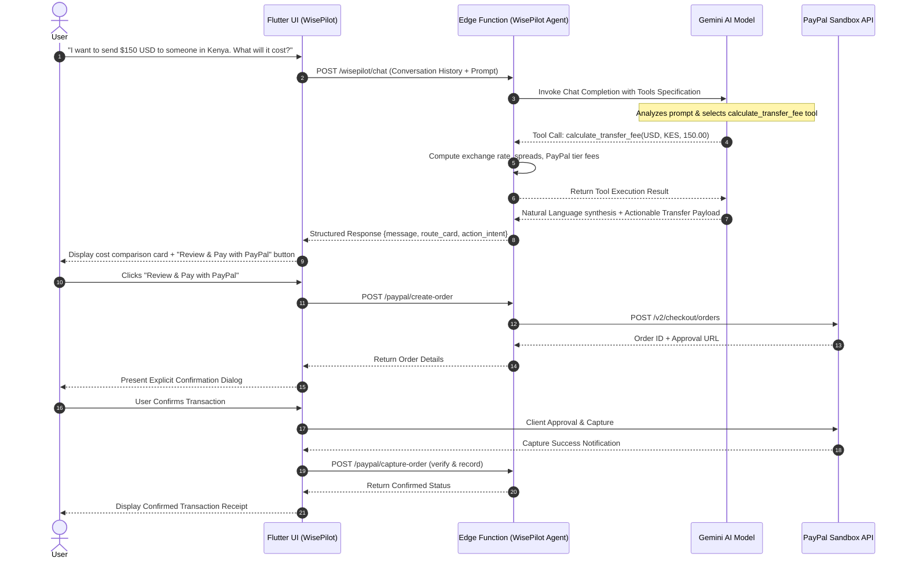
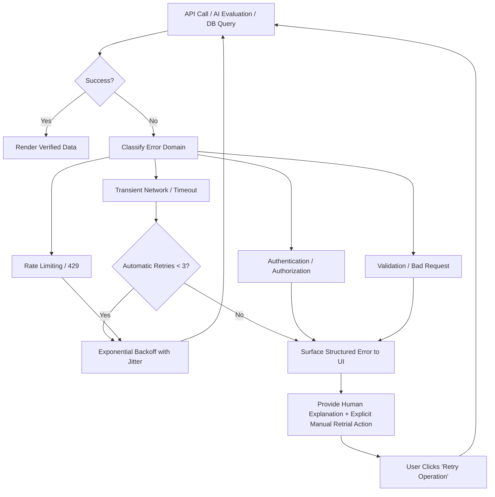

# System Architecture Specification

## Veltro — Intelligent Global Payments & Anti-Scam Platform

---

## 1. High-Level System Architecture

Veltro is designed as a distributed, modular fintech architecture with a decoupled client layer, serverless backend, specialized AI reasoning pipelines, and direct integration with the PayPal Developer Sandbox.

```mermaid
flowchart TD
    subgraph ClientLayer ["Client Layer (Flutter Cross-Platform)"]
        UI_Home["Veltro Home Dashboard"]
        UI_Payments["Global Payments & Calculator"]
        UI_Pilot["WisePilot AI Conversational Interface"]
        UI_Shield["Veltro Shield Security Scanner"]
        UI_Tx["Transaction Centre & Ledger"]
        
        StateMgr["State Management (Clean Architecture / Riverpod)"]
        IconMgr["Standard Icon System (Material Symbols)"]
        ErrorPresenter["Explicit Error Reporter & Retrial Coordinator"]
    end

    subgraph BackendLayer ["Backend Services (Supabase)"]
        SupaAuth["Supabase Authentication (JWT)"]
        SupaDB[("PostgreSQL Database with RLS")]
        SupaStorage["Secure Evidence Vault (Encrypted Storage)"]
        EdgeFunctions["Edge Functions (TypeScript / Deno)"]
    end

    subgraph AIOrchestration ["AI & Threat Intelligence Engine"]
        GeminiOrchestrator["Gemini AI Gateway (Function Calling)"]
        WisePilotAgent["WisePilot Financial Co-Pilot"]
        ShieldEngine["Veltro Shield Multi-Modal Threat Analyzer"]
        ThreatIntel["Domain Reputation & Heuristic URL Scanner"]
    end

    subgraph PaymentRails ["PayPal Developer Platform (Sandbox)"]
        PP_Auth["OAuth 2.0 Token Service"]
        PP_Orders["Orders API v2 (Create / Capture)"]
        PP_Payouts["Payouts API v1 (Cross-Border Batches)"]
        PP_Webhooks["Webhook Ingestion & Cryptographic Verification"]
    end

    %% Interactions
    ClientLayer --> |Authenticated HTTPS / WSS| BackendLayer
    ClientLayer --> |Standard Icons Only| IconMgr
    ClientLayer --> |Explicit Error Interception| ErrorPresenter
    
    BackendLayer --> |Secure Function Calls| AIOrchestration
    BackendLayer --> |Server-to-Server Mutual TLS| PaymentRails
    
    EdgeFunctions --> |Create / Capture / Status| PP_Orders
    EdgeFunctions --> |Structured Prompts / Tools| GeminiOrchestrator
    
    ShieldEngine --> |Scan Text, OCR, URLs| ThreatIntel
    ShieldEngine --> |JSON Schema Risk Output| EdgeFunctions
```



---

## 2. Technology Stack & Component Specifications

| Architectural Tier | Technology / Service | Implementation Purpose |
| :--- | :--- | :--- |
| **Frontend Framework** | Flutter Web & Mobile (Dart 3.x) | Single codebase delivering responsive desktop, tablet, and mobile web experiences. |
| **Design & Iconography** | Material Design 3 (`Icons.*`, `Symbols.*`) | Strictly standard vector iconography. Complete prohibition of emojis and low-quality SVG assets. |
| **State Management** | Flutter Riverpod / Clean Architecture | Strict separation of Data, Domain, and Presentation layers with deterministic state modeling. |
| **Backend & Database** | Supabase (PostgreSQL 15+) | Managed transactional database with Row-Level Security (RLS) guaranteeing tenant isolation. |
| **Serverless Compute** | Supabase Edge Functions (Deno/TypeScript) | Handles secret-bearing communications (PayPal client secrets, Gemini API keys, security hash verification). |
| **AI Reasoning Layer** | Google Gemini 1.5 Pro / Flash | Dual-role: Agentic function calling for WisePilot, multi-modal OCR/NLP reasoning for Veltro Shield. |
| **Payment Integration** | PayPal Developer Platform (Sandbox) | v2/checkout/orders, v1/payments/payouts, transaction queries, and webhook listeners. |
| **Domain & Threat Intelligence** | URL Inspection & Heuristic Engine | Validates domain age, typo-squatting, certificate anomalies, and known malicious indicators. |

---

## 3. Database Schema & Data Models

All tables are protected with PostgreSQL Row Level Security (RLS) so that authenticated users may only query and modify their own records.

```sql
-- 1. Profiles Table (Extends Supabase auth.users)
CREATE TABLE public.profiles (
    id UUID PRIMARY KEY REFERENCES auth.users(id) ON DELETE CASCADE,
    email TEXT NOT NULL UNIQUE,
    full_name TEXT NOT NULL,
    default_currency VARCHAR(3) DEFAULT 'USD',
    risk_tolerance_level TEXT DEFAULT 'BALANCED',
    created_at TIMESTAMPTZ DEFAULT NOW(),
    updated_at TIMESTAMPTZ DEFAULT NOW()
);

-- 2. Transactions Table (PayPal synchronized)
CREATE TABLE public.transactions (
    id UUID PRIMARY KEY DEFAULT gen_random_uuid(),
    user_id UUID NOT NULL REFERENCES public.profiles(id) ON DELETE CASCADE,
    paypal_order_id TEXT UNIQUE,
    paypal_capture_id TEXT UNIQUE,
    sender_email TEXT NOT NULL,
    recipient_identifier TEXT NOT NULL,
    source_currency VARCHAR(3) NOT NULL,
    target_currency VARCHAR(3) NOT NULL,
    send_amount NUMERIC(12, 2) NOT NULL,
    fee_amount NUMERIC(12, 2) NOT NULL,
    exchange_rate NUMERIC(12, 6) NOT NULL,
    recipient_amount NUMERIC(12, 2) NOT NULL,
    payment_method TEXT NOT NULL, -- 'PAYPAL_BALANCE', 'PAYPAL_CARD', etc.
    status TEXT NOT NULL, -- 'PENDING', 'CREATED', 'APPROVED', 'COMPLETED', 'FAILED', 'DENIED'
    metadata JSONB DEFAULT '{}'::jsonb,
    created_at TIMESTAMPTZ DEFAULT NOW(),
    updated_at TIMESTAMPTZ DEFAULT NOW()
);

-- 3. Veltro Shield Security Scans Table
CREATE TABLE public.shield_scans (
    id UUID PRIMARY KEY DEFAULT gen_random_uuid(),
    user_id UUID NOT NULL REFERENCES public.profiles(id) ON DELETE CASCADE,
    scan_type TEXT NOT NULL, -- 'MESSAGE', 'LINK', 'RECEIPT', 'INVOICE'
    input_payload TEXT NOT NULL,
    evidence_file_url TEXT,
    risk_level TEXT NOT NULL, -- 'LOW', 'MEDIUM', 'HIGH', 'CRITICAL'
    confidence_score NUMERIC(5, 2) NOT NULL,
    summary TEXT NOT NULL,
    detected_indicators JSONB NOT NULL DEFAULT '[]'::jsonb,
    recommended_actions JSONB NOT NULL DEFAULT '[]'::jsonb,
    raw_ai_analysis JSONB,
    created_at TIMESTAMPTZ DEFAULT NOW()
);

-- 4. Incident Reports Table (Archived threat intelligence)
CREATE TABLE public.incident_reports (
    id UUID PRIMARY KEY DEFAULT gen_random_uuid(),
    user_id UUID NOT NULL REFERENCES public.profiles(id) ON DELETE CASCADE,
    scan_id UUID REFERENCES public.shield_scans(id) ON DELETE SET NULL,
    report_title TEXT NOT NULL,
    threat_category TEXT NOT NULL, -- 'PHISHING', 'FAKE_RECEIPT', 'OVERPAYMENT', 'IMPERSONATION'
    incident_details TEXT NOT NULL,
    status TEXT DEFAULT 'OPEN', -- 'OPEN', 'UNDER_REVIEW', 'RESOLVED'
    created_at TIMESTAMPTZ DEFAULT NOW()
);

-- 5. Audit Log Table (Immutable ledger of security and payment events)
CREATE TABLE public.audit_logs (
    id BIGSERIAL PRIMARY KEY,
    user_id UUID REFERENCES public.profiles(id) ON DELETE SET NULL,
    action_type TEXT NOT NULL,
    entity_id TEXT,
    ip_address INET,
    details JSONB NOT NULL,
    created_at TIMESTAMPTZ DEFAULT NOW()
);
```

---

## 4. AI Orchestration & WisePilot Agent Architecture

WisePilot operates through an agentic loop governed by Google Gemini tool calling. The assistant never executes transactions directly; instead, it synthesizes intent, calls deterministic mathematical and API tools, and returns structured data payloads for user verification.



### 4.1 WisePilot Tool Calling Specifications

```json
[
  {
    "name": "calculate_transfer_fee",
    "description": "Calculates detailed fees, foreign exchange rates, and net delivery amounts for cross-border routes.",
    "parameters": {
      "type": "object",
      "properties": {
        "source_currency": {"type": "string", "description": "3-letter ISO currency code of sender"},
        "target_currency": {"type": "string", "description": "3-letter ISO currency code of recipient"},
        "send_amount": {"type": "number", "description": "Gross amount to send"}
      },
      "required": ["source_currency", "target_currency", "send_amount"]
    }
  },
  {
    "name": "check_country_support",
    "description": "Validates PayPal corridor support, payout options, and compliance requirements for a specific nation.",
    "parameters": {
      "type": "object",
      "properties": {
        "country_code": {"type": "string", "description": "2-letter ISO country code (e.g., NG, KE, PH, US)"}
      },
      "required": ["country_code"]
    }
  },
  {
    "name": "query_paypal_transaction",
    "description": "Queries direct PayPal Sandbox API to check verified status of a transaction ID. Screenshots are never used.",
    "parameters": {
      "type": "object",
      "properties": {
        "transaction_id": {"type": "string", "description": "PayPal Order or Capture ID"}
      },
      "required": ["transaction_id"]
    }
  },
  {
    "name": "scan_security_threat",
    "description": "Hands off suspicious input to Veltro Shield security engine.",
    "parameters": {
      "type": "object",
      "properties": {
        "threat_type": {"type": "string", "enum": ["MESSAGE", "URL", "RECEIPT", "INVOICE"]},
        "content": {"type": "string", "description": "Raw text or URL to evaluate"}
      },
      "required": ["threat_type", "content"]
    }
  }
]
```

---

## 5. PayPal Developer Sandbox Integration

### 5.1 Authentication & Token Lifecycle
* Secure server-side credential management: Client ID and Secret are never embedded in the client binary.
* Edge Functions request short-lived OAuth 2.0 Bearer tokens via `https://api-m.sandbox.paypal.com/v1/oauth2/token` using HTTP Basic Authentication. Tokens are cached in memory until expiration.

### 5.2 Order Creation Flow (`POST /v2/checkout/orders`)
* Generates an order with explicit breakdown:
  * `intent`: `CAPTURE`
  * `purchase_units`: Contains currency code, item total, shipping/service fee, and custom order description.
  * `application_context`: Enforces `user_action: CONTINUE` to maintain user control and explicit confirmation.

### 5.3 Capture & Webhook Settlement
* Client completes approval and initiates capture via secure Edge Function.
* Webhook listener receives `PAYMENT.CAPTURE.COMPLETED`, cryptographically validates the PayPal signature header against the public certificate, and updates the local PostgreSQL ledger.

---

## 6. Strict Resilience & Fault-Tolerance Policy

### 6.1 Prohibition of Silent Fallbacks
* **Strict Rule:** The system must never degrade silently or substitute synthetic "dummy" data when an operation fails. 
* Fallback states that mask network failure, API downtime, or AI timeouts create dangerous false security in a financial application.

### 6.2 Error Architecture & Retrial Contract
All services adhere to the following deterministic error protocol:



1. **Transient Network or Service Timeouts:**
   * Executed with automatic retrial (maximum 3 attempts) using exponential backoff with full jitter ($t = \text{base} \cdot 2^{\text{attempt}} \pm \text{jitter}$).
   * If all automated retrials exhaust, the system presents a high-visibility error card detailing the failed endpoint, HTTP status code, and an explicit "Retry Now" button.
2. **AI Provider Errors or Refusals:**
   * Clearly report: "AI reasoning service temporarily unavailable. The system will not generate unverified safety or fee estimates."
   * Offer immediate manual retry option without wiping user inputs.
3. **PayPal API Errors:**
   * Parse PayPal error JSON (`name`, `message`, `debug_id`).
   * Display exact issue to user (e.g., "PayPal Sandbox rejected currency pair USD to XYZ due to regional restrictions. Debug ID: 94821038").
