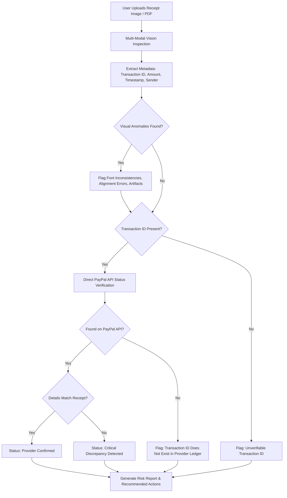

# Veltro Shield — Anti-Scam Security Specification

**Document Version:** 1.0.0  
**Subsystem:** Threat Mitigation & Risk Assessment Engine  
**Core Thesis:** Proactive, pre-transaction scam detection that evaluates risk indicators without making defamatory accusations, never accepts screenshots as proof of settlement, and verifies transaction status via direct provider APIs.

---

## 1. Ethical Governance & Core Principles

1. **Risk Indicators Over Accusation:**
   Findings are strictly framed as objective risk indicators (e.g., "Elevated probability of impersonation", "Inconsistent font rendering detected in transaction header"), never as definitive legal accusations ("The counterparty is a criminal").
2. **The "Zero Trust in Screenshots" Rule:**
   Visual artifacts (PNG/JPEG receipts, email confirmations, SMS screenshots, banking app capture screens) can be manipulated in seconds using client inspection tools or image editors. Veltro Shield establishes as an inviolable rule:
   > **A screenshot or visual receipt is never proof of funds arrival.** Legitimate receipt of funds can only be validated via direct query against the payment provider's ledger API (e.g., PayPal Sandbox / Production Transaction Lookup).
3. **No Automated Blocking Without Recourse:**
   AI evaluations serve as assistive decision-support tools. The system advises caution, outlines specific red flags, and recommends verified workflows, but does not freeze non-custodial external assets without human discretion.
4. **Data Minimization & Redaction:**
   During visual or textual analysis, credit card numbers (PANs), passwords, bank CVVs, and government identity numbers are detected and redacted on the client side before submission to the cloud reasoning engine.

---

## 2. Threat Detection Modules

### 2.1 Module 1: Suspicious Message & Email Detection

Analyzes conversational transcripts, marketplace chats, email bodies, and direct messages for cognitive exploitation and social-engineering markers.

#### Primary Risk Indicators Monitored
* **Manufactured Urgency:** Demands for immediate payment under threat of account closure, legal penalty, or lost opportunities.
* **Payment Redirection Tactics:** Pressuring the user to bypass platform escrow or standard checkout methods (e.g., "Send via Friends and Family", "Pay outside the marketplace to avoid taxes").
* **Overpayment & Refund Scheme:** Claiming an accidental overpayment and requesting the "excess" be wired back before the original payment clears.
* **Authority Impersonation:** Posing as PayPal Security, customer support, or escrow managers using informal language or unverified contact channels.
* **Advance Fee Fraud:** Promising massive payouts, lottery winnings, or contract retainers contingent upon a prior "clearance fee" or "foreign exchange deposit".

#### Risk Scoring Formulation
The message evaluation engine computes a normalized Threat Vector Score ($S \in [0, 100]$) based on linguistic markers:
$$S_{\text{message}} = \sum_{i=1}^{n} w_i \cdot I_i$$
where $w_i$ represents the weight of specific heuristic indicators (Urgency: $25$, Off-Platform Request: $30$, Overpayment Cue: $35$, Grammar/Impersonation Artifact: $10$).

---

### 2.2 Module 2: Fake Payment Confirmation & Receipt Verification

Evaluates submitted digital receipts, email screenshots, and payment confirmations to detect visual anomalies and fraudulent claims.



#### Key Visual Checks
* **Font and Typography Uniformity:** Detects discrepancies between standard system typefaces and overlaid text (e.g., altered dollar amounts or edited recipient names).
* **Alignment and Boundary Artifacts:** Flags pixelation around numbers, mismatched bounding boxes, or irregular background compression halos.
* **Missing Crucial Identifiers:** Identifies missing or mathematically invalid PayPal transaction reference formats (standard 17-character alphanumeric string).
* **Definitive Rule:** Irrespective of visual cleanliness, the report explicitly states: *"Visual receipt verified for layout consistency only. To verify actual cash receipt, check your official PayPal account balance directly."*

---

### 2.3 Module 3: Suspicious Link & Phishing Inspector

Evaluates outbound hyperlinks provided in payment instructions or invoice emails.

#### Heuristic and Technical Verification Pipeline
1. **Domain Lexical Analysis:**
   * Detects typosquatting and homoglyph attacks (e.g., `paypa1-support.com`, `paypal-verify.net`, `secure-paypal.io`).
   * Evaluates sub-domain spoofing (e.g., `paypal.com.account-verification.cc`).
2. **Top-Level Domain (TLD) Threat Index:**
   * Flags high-risk, ephemeral TLDs known for transient phishing campaigns.
3. **Redirection & Cloaking Detection:**
   * Inspects URL shorteners and multi-hop HTTP 301/302 redirects masking the destination host.
4. **Threat Intelligence Correlation:**
   * Cross-references destination URLs against verified safety heuristics and reputation databases.

---

### 2.4 Module 4: Invoice & Payment Request Verification

Reviews commercial invoices and billing requests, specifically designed to protect freelancers and merchants against Business Email Compromise (BEC).

#### Verification Criteria
* **Payee Identity Drift:** Compares newly requested payout details against historical vendor profiles.
* **Bank / Routing Routing Changes:** Triggers elevated warnings if an existing invoice suddenly changes settlement currency or payment destination.
* **Amount Discrepancy:** Evaluates unexpected handling surcharges, unexpected conversion fees, or unjustified foreign taxes.

---

## 3. Scam Risk Classification Matrix

Veltro Shield maps all multi-modal signals into four standard risk tiers:

| Risk Tier | Score Range | Definition | User Experience / UI State | Recommended User Action |
| :--- | :--- | :--- | :--- | :--- |
| **LOW** | 0 — 24 | Standard transaction markers. Verified sender domain, consistent metadata, no urgency tactics. | Green indicator with standard shield icon. | Proceed with standard diligence. Confirm receipt in account. |
| **MEDIUM** | 25 — 59 | Ambiguous indicators present. Off-platform contact request, unverified domain, or missing transaction details. | Amber warning banner with outlined alert icon. | Request verified invoice through official platform channels before dispatching work. |
| **HIGH** | 60 — 84 | Multiple strong fraud markers. High-pressure deadlines, forged email headers, or suspicious redirection links. | Orange prominent alert with high-visibility warning container. | Do not send money or release goods. Verify counterparty identity through independent phone call. |
| **CRITICAL** | 85 — 100 | Direct evidence of fraud. Known malicious phishing URL, fabricated transaction ID not found on PayPal, or overpayment refund demand. | Red alert card with clear warning callout. Explicit confirmation required to proceed. | Cease all communication. Do not click links. Report transaction to official PayPal resolution center. |

---

## 4. Structured Output JSON Schema

When Veltro Shield completes an inspection, the edge function produces a strictly typed JSON payload:

```json
{
  "scan_id": "8e3c49e2-9b2f-45b1-bf52-2580a1329c01",
  "timestamp": "2026-11-10T08:30:00Z",
  "scan_type": "MESSAGE",
  "risk_tier": "HIGH",
  "confidence_score": 0.88,
  "summary": "This message exhibits classic overpayment scam patterns with manufactured urgency and an off-platform payment request.",
  "risk_indicators": [
    {
      "indicator_code": "IND_OVERPAYMENT_CLAIM",
      "severity": "HIGH",
      "description": "Counterparty claims to have sent 500 USD extra by accident and demands immediate refund via an irreversible wire transfer."
    },
    {
      "indicator_code": "IND_FALSE_ESCROW",
      "severity": "HIGH",
      "description": "Sender claims PayPal is holding funds until an external courier fee is paid. PayPal does not operate third-party courier escrow."
    },
    {
      "indicator_code": "IND_URGENCY_TACTIC",
      "severity": "MEDIUM",
      "description": "Message insists on settlement within 2 hours under threat of reporting account."
    }
  ],
  "recommended_actions": [
    "Do not refund any money or send funds to third-party couriers.",
    "Log in directly to your official PayPal dashboard at https://www.paypal.com to inspect actual account balance.",
    "Do not trust screenshots or third-party confirmation emails.",
    "Report this sender through the platform where communication originated."
  ],
  "provider_verification": {
    "checked": true,
    "provider": "PayPal Sandbox",
    "transaction_id_found": false,
    "note": "The reference code provided does not exist in PayPal transaction records."
  }
}
```

---

## 5. Scam Education & Community Incident Reporting

1. **Scam Knowledge Hub:**
   * Interactive guides explaining the mechanics of common schemes: "The Fake PayPal Confirmation Email", "The Shipping Agent Overpayment Trap", "The Phishing Dispute Link", and "The Foreign Exchange Reversal".
   * Each guide details: The Attacker's Playbook, Red Flags to Spot, and What To Do If Targeted.
2. **Incident Repository:**
   * Users can anonymize and save suspicious messages or links into their personal security archive.
   * Compiles structured reports for submission to law enforcement or platform abuse teams.
